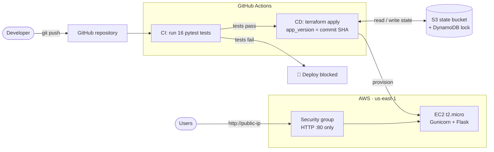

# DevOps Health Dashboard


A real-time server health dashboard built with **Python** and **Flask**, tested with **pytest**, and deployed to **AWS EC2** by a **GitHub Actions** pipeline that provisions the infrastructure with **Terraform**. A deployment only happens after all 16 automated tests pass.

---

## Architecture



**How a release works**

1. A push to `main` starts the **CI** job, which installs dependencies and runs all 16 tests.
2. If every test passes, the **CD** job runs `terraform apply` and passes the **commit SHA** as `app_version`.
3. Terraform reads the current state from **S3** (locked with **DynamoDB** so two runs can't collide).
4. Because the commit SHA changed, Terraform **replaces the EC2 instance** with a fresh one. On boot, the new instance clones the repo, checks out that exact commit, and starts the app with **Gunicorn** on port 80.
5. The pipeline prints the new dashboard URL.

Replacing the server on every release instead of patching it in place is called an **immutable deployment**. Every running server matches a specific commit, and there's no configuration drift.

---

## Features

- **Live system metrics:** CPU, memory, and disk usage collected with `psutil`
- **REST API:** JSON endpoints for health checks and raw metrics
- **16 automated tests:** unit tests for the metrics module and integration tests for every route
- **CI on every push and pull request:** broken code never reaches `main` unnoticed
- **Gated CD:** infrastructure changes and deployments only run after tests pass
- **Infrastructure as Code:** the server, firewall rules, and state backend are all defined in Terraform
- **Remote state with locking:** safe to run Terraform from the pipeline and a laptop

---

## Tech Stack

| Layer | Technology |
|---|---|
| Application | Python 3.11, Flask, psutil |
| Web server | Gunicorn |
| Testing | pytest (16 tests) |
| CI/CD | GitHub Actions |
| Infrastructure as Code | Terraform with S3 remote state and DynamoDB locking |
| Cloud | AWS EC2 (Amazon Linux 2), security groups |

---

## API Endpoints

| Method | Endpoint | Description |
|---|---|---|
| `GET` | `/` | Dashboard UI with live CPU, memory, and disk usage |
| `GET` | `/health` | Health check, returns `{"status": "healthy"}` |
| `GET` | `/metrics` | Raw system metrics as JSON |

**Example**

```bash
curl http://localhost:5000/metrics
```

```json
{
  "cpu_percent": 12.5,
  "memory": { "total_gb": 7.67, "used_gb": 3.12, "percent": 40.7 },
  "disk":   { "total_gb": 98.3, "used_gb": 41.6, "percent": 42.3 }
}
```

---

## Project Structure

```
devops-health-dashboard/
├── app/
│   ├── __init__.py            # Flask app setup
│   ├── routes.py              # Dashboard, /health, and /metrics endpoints
│   ├── metrics.py             # CPU, memory, and disk collection with psutil
│   └── templates/
│       └── dashboard.html     # Dashboard UI
├── tests/
│   ├── test_metrics.py        # 9 unit tests for the metrics module
│   └── test_routes.py         # 7 integration tests for the API routes
├── terraform/
│   ├── backend.tf             # S3 remote state + DynamoDB locking
│   ├── main.tf                # EC2 instance and security group
│   ├── variables.tf           # Region, instance type, app version
│   └── outputs.tf             # Dashboard URL, instance ID, public IP
├── .github/workflows/
│   ├── test.yml               # CI: tests on every push and pull request
│   └── deploy.yml             # CD: test, then terraform apply
├── run.py                     # Local development entry point
└── requirements.txt
```

---

## Run Locally

```bash
git clone https://github.com/mopaul873/devops-health-dashboard.git
cd devops-health-dashboard

python -m venv venv
source venv/bin/activate        # Windows: venv\Scripts\activate

pip install -r requirements.txt
python run.py
```

Open http://127.0.0.1:5000.

## Run the Tests

```bash
pytest tests/ -v
```

---

## Deploy to AWS

### 1. Create the state backend (one time)

```bash
aws s3api create-bucket --bucket mopaul873-devops-dashboard-tfstate --region us-east-1
aws s3api put-bucket-versioning --bucket mopaul873-devops-dashboard-tfstate \
  --versioning-configuration Status=Enabled

aws dynamodb create-table --table-name mopaul873-devops-dashboard-tflocks \
  --attribute-definitions AttributeName=LockID,AttributeType=S \
  --key-schema AttributeName=LockID,KeyType=HASH \
  --billing-mode PAY_PER_REQUEST --region us-east-1
```

S3 bucket names are global, so change the names in `terraform/backend.tf` if you deploy this in your own account.

### 2. Deploy manually

```bash
cd terraform
terraform init
terraform plan
terraform apply
```

### 3. Or let the pipeline deploy

Add `AWS_ACCESS_KEY_ID` and `AWS_SECRET_ACCESS_KEY` as repository secrets (**Settings → Secrets and variables → Actions**). Every push to `main` will then test and deploy automatically.

### 4. Clean up

```bash
terraform destroy
```

---

## What I Learned

- Structuring a Flask app and writing **unit and integration tests** with pytest
- Building a **CI pipeline** that runs on every push and pull request
- **Gating deployments** on passing tests so broken code can't reach production
- Why Terraform needs **remote state**: without it, every pipeline run starts from nothing and tries to recreate resources that already exist
- Using **immutable deployments**, replacing servers instead of patching them
- Tightening a **security group** to only the ports the app needs

---

## Roadmap

- [ ] Put the instance behind an Application Load Balancer for a stable URL and zero-downtime releases
- [ ] Run the app as a `systemd` service so it restarts automatically after a reboot
- [ ] Containerize the app with Docker
- [ ] Switch the pipeline from access keys to **GitHub OIDC**
- [ ] Look up the latest Amazon Linux AMI with a Terraform data source instead of a fixed AMI ID
- [ ] Send metrics to CloudWatch and add alarms

---

## Author

**Paul Momo** · AWS Certified Cloud Practitioner · B.S. Computer Science (expected June 2027) · [GitHub](https://github.com/mopaul873)
